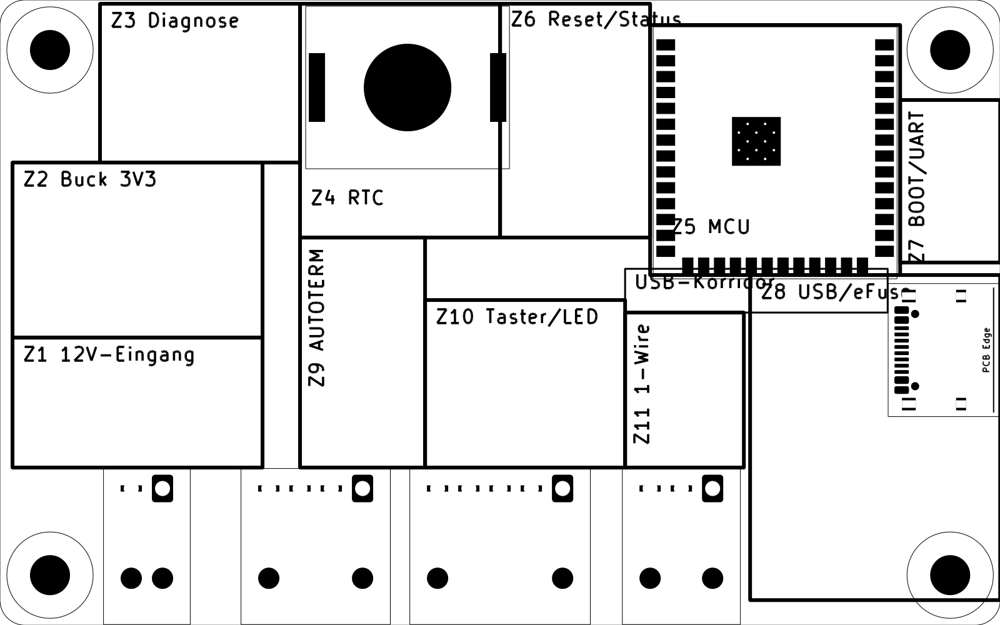

# Platzierung – Schritt 1 und 2: Schaltungsanalyse und funktionaler Floorplan

Stand: 2026-10-14 · Grundlage: [PCB Layout Engineering Instructions](../docs/PCB_Layout_Engineering_Instructions.md), [Anforderungsdokument v2.1](../docs/Anforderungsdokument_Neuentwicklung.md), [Schaltungsentwurf](Schaltungsentwurf.md)
Vergleichsbasis: Git-Tag `placement-baseline-1` (verbindungslängen-optimierte Platzierung, wird ersetzt)

Dieses Dokument ist der Meilenstein vor der Bauteilplatzierung. Erst nach seiner Freigabe folgen die hierarchische Platzierung (Schritt 3), die elektrische Optimierung (Schritt 4) und die Validierung (Schritt 5). Geroutet wird erst nach freigegebener Platzierung.

---

## 1. Schaltungsanalyse

### 1.1 Funktionsblöcke und Bauteilzuordnung

139 Footprints = 132 Schaltplanbauteile + 4 Befestigungslöcher + 3 Passermarken. Die Zuordnung folgt der Schaltungsfunktion laut Schaltplan, nicht den Referenzbezeichnern.

| Block | Funktion | Bauteile |
|---|---|---|
| **B1 12-V-Eingang und Schutz** | Verpolschutz, Transientenschutz, Pi-Filter, Bulk | J1, D1 (TVS), D2 (Schottky), C26, FB1, C1, TP1, TP2, TP7 (GND) |
| **B2 USB-Eingang** | USB-C, CC-Terminierung, ESD, eFuse, ODER-Diode | J5, R1, R2, D3, U1, C17, C18 (DNP), C2, U2, R3, R4, R5, R6, C3, C4 (DNP), C5, D4, TP5, TP6, TP15 (GND) |
| **B3 3,3-V-Schaltregler** | VIN_SYS → 3V3_CORE, 2,2 MHz | U3, C6, C7, C8, C9, L1, C10, C11, TP3, TP4 |
| **B4 MCU** | ESP32-S3-WROOM-1U, Abblockung, USB-Serien-R, UART0 | U4, C12, C13, C14, R9, R10, R11, TP10, TP11 |
| **B5 Reset/Boot** | Supervisor, EN-RC, Taster | U5, C16, R7, C15, SW1, R8, SW2, TP8, TP9 |
| **B6 RTC** | RTC mit Knopfzelle, Dioden-ODER, I2C-Pull-ups | U6, C19, D5, D6, BT1, R12, R13, R14, TP12, TP13, TP14 |
| **B7 AUTOTERM** | 5-V-UART zur Heizung, Pegelwandler | J2, D7, R15, C20, C22, U7, C21, R16, R17, R18, D8, TP16–TP21 |
| **B8 1-Wire** | Sensorversorgung (Lastschalter), Datenleitung | J3, U8, C23, C24, R19, R20, R21, D9, TP22, TP23 |
| **B9 Taster/Ring-LED** | Taster-Eingang mit RC, LED-Konstantstrom | J4, D10, R22, R23, C25, F1, U9, R24, R25, TP26, TP27 |
| **B10 Diagnoseanzeige** | 5 LEDs im Energiefluss-Bild (G-01), DIAG-Taster | D11 (12V), D12 (USB), D13 (3V3), D19 (RUN), D14 (HEAT), D15–D18, Q1, R26–R31, SW3, TP24, TP25, TP28 |
| **B11 Status-LEDs** | 2 GPIO-LEDs | D20, D21, R32, R33, R34, R35 |
| **Mechanik/Fertigung** | Befestigung, Bestückung | H1–H4, FID1–FID3 |

### 1.2 Strompfade

| Pfad | Strom (Auslegung) | Herleitung | Folgerung |
|---|---|---|---|
| J1 → D2 → FB1 → VIN_SYS | ≤ 0,2 A Betrieb, 1 A extern abgesichert | 1,65 W (3,3 V × 0,5 A) / (12 V × 85 %) ≈ 0,16 A + Ring-LED 10 mA | Bahn für 1 A (Sicherungswert), kurz |
| J5 VBUS → U2 → D4 → VIN_SYS | ≤ 0,5 A, eFuse-Grenze 1 A | wie oben aus 5 V ≈ 0,4 A | für 1 A; IN/OUT der eFuse mit Kupfer und Vias (Wärme, Datenblatt) |
| Buck-Eingangsschleife C7–VIN–GND | Pulsstrom bis ≈ 0,8 A, Flanken ns | 2,2 MHz, Schaltregler | **kritische Hot-Loop**: kleinste Fläche (TI 8.5.1) |
| SW-Knoten U3.5 → L1 | Dreieck ≈ 0,5 A ± Ripple | | Fläche minimal, Störquelle |
| 3V3_CORE → U4 | ≤ 0,5 A (Datenblatt IVDD 0,5 A; TX-Spitze 355 mA) | WROOM-1U-Datenblatt | Bahn ≥ 0,65 mm (Espressif 25 mil), 22 µF am Modul |
| Ring-LED VIN_SYS → F1 → J4 → U9 | 10 mA (REXT offen) | BCR421 | Wärme in U9: (14,4 V − V_LED) × 10 mA ≤ 0,13 W |
| 3V3_SENSOR_SW → J3 | ≤ 0,1 A (Lastschalter-Grenze) | TPS22945 | unkritisch |
| AUTOTERM_5V → U7 VCCB, HEAT-LED | einige mA | | unkritisch |

### 1.3 Kritische Signale und Störquellen

| Netz/Bereich | Art | Anforderung |
|---|---|---|
| `SW_BUCK`, L1 | Störquelle, 2,2 MHz, steile Flanken | klein halten; Abstand zu RTC/I2C, U.FL, 1-Wire, USB (Y-04) |
| USB D+/D− (`USB_D*`) | 12 Mbit/s, 90 Ω differentiell | kurz, stubfrei, über durchgehender GND (Y-03); ESD am Stecker, Serien-R am Modul (G-04) |
| U.FL am Modul | 2,4 GHz Antennenanschluss | Freiraum, keine schnellen Leitungen (Espressif) |
| `EN`, `BOOT_N` | Reset/Strapping | kurz, fern vom SW-Knoten, RC an EN (WROOM-Datenblatt: 10 kΩ/1 µF) |
| `I2C_*`, `RTC_INT_N`, RTC | langsam, hochohmige Pull-ups | fern vom SW-Knoten (Y-04) |
| `Net-(U2-ILM)` | Strombegrenzungs-Einstellung der eFuse | kurz, < 50 pF, fern von Schaltsignalen (TPS25947 8.4.1) |
| U5 CT-Pin (offen) | Verzögerung 20 ms | Streukapazität minimal, keine Leitungen nahe (TPS3808 8.4.1) |
| `1WIRE_DQ_C`, `CTRL_*`, `BUTTON_N_C`, `LED_*` | Außenleitungen bis 3 m | Schutz direkt am Stecker; ungeschützte Leitung kurz (TPD2EUSB30/ESD-Leitfäden) |
| U0TXD/U0RXD | Testpads | kurz, Serien-R am Modul, fern vom U.FL (Espressif) |

### 1.4 Datenblatt-Anforderungen an die Platzierung

| Bauteil | Anforderung | Quelle |
|---|---|---|
| U3 LMR43620 | CIN direkt an VIN (Pin 3/4) und GND (Pin 9); CVCC (C8) und CBOOT (C9) nah, kurz und breit; SW-Fläche minimal; VOUT-Messung nicht neben SW; Massefläche in einer Innenlage; laute Ströme auf einer Seite der Masse | LMR43620-Q1 SNVSBE0H, 8.5.1, Fig. 8-31/8-32 |
| U2 TPS25947 | ≥ 0,1 µF IN–GND direkt an den Pins; RILM, CdVdT, CITIMER, Teiler nah an ihren Pins mit kurzer Rückführung zu GND; ILM fern von Schaltsignalen; IN/OUT mit Kupfer und Vias zur Wärmeableitung; Schutzbauteile nah am zu schützenden Teil | TPS25947 SLVSFC9, 8.4.1 |
| U1 TPD2EUSB30 | so nah wie möglich am Stecker; geschützte Leitungen gerade, keine scharfen Ecken; ungeschützte Leitungen fern; GND mit großem Via | TPD2EUSB30, 10.1 |
| U7 TXU0202 | 0,1 µF an jedem Versorgungspin, so nah wie möglich | TXU0202-Q1, 11.1 |
| U8 TPS22945 | 1 µF an VIN, Ausgangskondensator an VOUT, beide nah; breite VIN/VOUT/GND | TPS22945, 11.1 |
| U5 TPS3808 | 0,1 µF nah an VDD; CT-Streukapazität minimal | TPS3808, 8.4.1 |
| U4 WROOM-1U | Landpattern unverändert; 10–22 µF + 100 nF am 3V3-Pin; EN-RC; UART-R am Modul; U.FL frei; GND-Vias dicht um das Modul; EPAD mit Vias (Pastenmenge beachten) | WROOM-1U-Datenblatt v1.8, Kap. 9/11; Espressif PCB Layout Design |
| U9 BCR421 | Wärme über die OUT-Pins (2, 3, 5): Kupferfläche; RθJA 105–140 °C/W mit 25–50 mm² Kupfer | BCR420/421UW6Q, Thermal Characteristics |
| D1, D3, D7–D10 | direkt am Stecker mit kurzem GND-Pfad | Y-06, G-07 |

### 1.5 Mechanische und Fertigungs-Randbedingungen

| # | Randbedingung | Quelle |
|---|---|---|
| K-01 | Kontur 80 × 50 mm, Ursprung (100, 100); Befestigungslöcher H1–H4 fest (freigegeben) | M-04, M-09 |
| K-02 | Nano-Fit J1–J4 an der gemeinsamen Unterkante, Reihenfolge J1, J2, J4, J3 | M-07, Phase 3 |
| K-03 | USB-C J5 an der rechten Kante, von außen erreichbar | M-06 |
| K-04 | U.FL, Knopfzelle, BOOT/RESET/DIAG, alle LEDs von oben zugänglich bzw. sichtbar | M-08 |
| K-05 | einseitige Bestückung; schwere Teile (C1, BT1, Stecker) gegen Vibration nahe an Befestigungspunkten bevorzugt | M-05, M-03 |
| K-06 | Diagnose-LEDs in der Anordnung `12V ●─┐ ├─● 3V3 ─● RUN ─● HEAT` / `USB ●─┘` mit Silkscreen-Linien | G-01 |
| K-07 | 3 Passermarken ≥ 3,35 mm vom Rand; Bauteile am Rand → Nutzenränder | G-10, G-11 |
| K-08 | Testpads beschriftet und zugänglich, USB D± nur stubfrei | A16 |
| K-09 | Lagen: L1 Bauteile/Signale, L2 GND ungeteilt, L3 Versorgung/langsame Signale, L4 GND/langsame Signale | Y-02 |

### 1.6 Befunde an der Vergleichsbasis (`placement-baseline-1`)

| # | Befund | Folge |
|---|---|---|
| F-01 | Diagnose-LEDs als gerade Reihe – entspricht nicht dem geforderten Bild G-01 (12V und USB übereinander, Zusammenführung zu 3V3 → RUN → HEAT) | neu anordnen |
| F-02 | Buck-Bauteile nach Verbindungslänge statt nach TI-Referenzlayout angeordnet (Lage von CIN, L1, COUT zueinander nicht geplant) | Referenzlayout übernehmen |
| F-03 | Testpunkte über die Fläche verteilt | blockweise am Blockrand gruppieren |
| F-04 | eFuse-Hilfsbauteile (R6 ILM, C3, R3–R5) nicht gezielt an ihren Pins | nach TPS25947 8.4.1 platzieren |
| F-05 | Gepolte Bauteile in zwei Richtungen, Bauteile nicht auf gemeinsamen Achsen | einheitlich ausrichten (Phase 5 der Anleitung) |
| F-06 | USB-Korridor unter der Modulunterkante nicht freigehalten | als Sperrkorridor einplanen |

### 1.7 Beobachtungen ohne Änderungsvorschlag

- **TPS22945:** Das Datenblatt empfiehlt am Ausgang typisch ein Zehntel der Eingangskapazität; bestückt ist C24 = 1 µF = C23. Funktional unkritisch (Strombegrenzung 100 mA, 1 µF lädt in < 0,1 ms). Keine Änderung vorgeschlagen.
- **TPS25947:** Das Datenblatt empfiehlt eine eigene Masse-Insel mit Sternpunkt. Y-02 fordert eine ungeteilte GND-Fläche auf L2. Umsetzung: U2-GND und die Hilfsbauteile auf einer lokalen L1-Massefläche mit einem Via-Punkt zu L2. Keine Teilung von L2.

---

## 2. Funktionaler Floorplan

### 2.1 Grundgedanke

1. **Energiefluss von links unten nach rechts oben:**
   - Der 12-V-Eingang (J1) und der Schaltregler liegen links unten, weit weg von RTC, U.FL, USB und 1-Wire.
   - Die 3,3 V gehen über die Versorgungslage L3 zum Modul rechts oben.
   - Der USB-Eingang liegt rechts. Seine eFuse sitzt unter J5, VBUS_PROT läuft über D4 auf L3 nach VIN_SYS.
2. **Modul rechts oben (Lage unverändert):**
   - Der U.FL sitzt an der Oberkante, zugänglich und fern vom Schaltregler.
   - Die linke Modulkante (GPIO 4–12) zeigt zur Platinenmitte: Status, Diagnose, RTC, AUTOTERM.
   - Die Unterkante (GPIO 9–14) zeigt zu den Steckern J4/J3.
3. **Schnittstellenblöcke direkt über ihren Steckern**, Schutzbauteile unmittelbar am Steckerpin.
4. **USB-Korridor:** Das Differenzpaar läuft auf L1 entlang der Modulunterkante von J5 zu Pad 13/14. Der Korridor bleibt bauteilfrei; langsame Signale kreuzen ihn auf L3.
5. **Ruhige Zone oben Mitte:** RTC und Knopfzelle, durch Diagnose und Reset-Bereich vom Schaltregler getrennt.

Erzeugt mit `tools/floorplan.py` auf einer Kopie der Leiterplatte, gerendert mit `kicad-cli`. Die Zone Z8 zeigt den Gesamtbereich; die Befestigungsloch-Sperrfläche um H4 (Radius 3,3 mm) bleibt frei. Der Streifen x 121–124 zwischen Z1/Z2 und Z9 ist der Trennabstand Schaltregler–AUTOTERM.

### 2.2 Zonen

Koordinaten in mm (KiCad, Ursprung der Platine bei (100, 100), y nach unten).

| Zone | Bereich x × y | Block | Leitregel |
|---|---|---|---|
| **Z1 12-V-Eingang** | 101–121 × 127–137,4 | B1 | D1 an J1-Pin 1 mit GND direkt zu J1-Pin 2; Kette D2 → C26 → FB1 → C1 in Flussrichtung nach oben |
| **Z2 Schaltregler** | 101–121 × 113–127 | B3 | TI-Referenzlayout: CIN (C7) an VIN/GND, L1 neben SW, COUT (C10/C11) neben L1, gemeinsamer GND-Punkt; SW zeigt vom Rest der Platine weg (zum linken Rand) |
| **Z3 Diagnoseanzeige** | 108–124 × 100,3–113 | B10 | LED-Bild nach G-01; Vorwiderstände und BAS116 hinter den LEDs; DIAG-Taster daneben |
| **Z4 RTC** | 124–140 × 100,3–119 | B6 | BT1 als großer Block oben; D5/D6 und C19 darunter; U6 mit I2C-Pull-ups an der Grenze zu Z6, nahe Modulpads 7–9 |
| **Z5 MCU** | 152–172 × 102–122 (Modul) | B4 | C14 an Pad 2, C12/C13 daneben; R9/R10 an Pad 13/14 |
| **Z6 Reset/Status** | 140–152 × 100,3–119 | B5, B11, U6 | SW1, U5 + C16, R7/C15 an EN (Pad 3); Status-LEDs sichtbar am Modul |
| **Z7 BOOT/UART** | 172–180 × 108–121 | B5, B4 | SW2 + R8 an Pad 27, R11 + TP10/TP11 unterhalb des U.FL-Bereichs |
| **Z8 USB/eFuse** | 160–180 × 122–148 | B2 | U1 und D3 direkt an J5; R1/R2 an CC; eFuse-Cluster unter J5 nach TPS25947 |
| **K USB-Korridor** | 150–171 × 121,5–125 | – | bauteilfrei außer R9/R10, U1; L1-Paar über L2-GND |
| **Z9 AUTOTERM** | 124–134 × 119–137,4 | B7 | D7/D8 an J2; R16/R17 zwischen Schutz und U7; U7 mit C20–C22 |
| **Z10 Taster/Ring-LED** | 134–150 × 124–137,4 | B9 | D10 an J4-Pin 1; U9 mit Kupferfläche an OUT; F1 im LED-Plus-Pfad |
| **Z11 1-Wire** | 150–159,5 × 125–137,4 | B8 | D9 an J3; U8 mit C23/C24 |

Testpunkte werden je Block an einer zugänglichen Blockkante in einer Reihe angeordnet, nicht verstreut. Ein GND-Messpad pro Blockgruppe: TP7 bei Z1, TP15 bei Z8, TP25 bei Z3.

### 2.3 Trennabstände

| Störquelle | Schutzgut | Abstand (Plan) |
|---|---|---|
| SW-Knoten/L1 (Z2) | RTC U6 | ≥ 25 mm |
| SW-Knoten/L1 (Z2) | USB-Korridor | ≥ 29 mm |
| SW-Knoten/L1 (Z2) | U.FL | ≥ 40 mm |
| SW-Knoten/L1 (Z2) | 1-Wire (Z11) | ≥ 29 mm |
| SW-Knoten/L1 (Z2) | AUTOTERM (Z9) | ≥ 3 mm Zonenabstand mit GND dazwischen (5-V-UART, robust) |
| eFuse ILM (Z8) | Schaltsignale | kein Schaltsignal in Z8 |

### 2.4 Platzierungsreihenfolge (Schritt 3)

1. **Mechanische Anker (fest):** H1–H4, J1–J5, Modul U4, Taster SW1–SW3, Diagnose- und Status-LEDs, Knopfzellenhalter BT1, Passermarken.
2. **Große ICs:** U3 + L1 (Referenzlayout), U2, U1, U7, U8, U9, U5, U6.
3. **Kritische Passive:**
   - Abblockung (C7, C8, C9, C10/C11, C14, C16, C19, C21/C22, C23/C24, C2/C5).
   - eFuse-Einsteller (R3–R6, C3, C4).
   - Schutz (D1–D3, D7–D10).
   - USB-R (R9/R10), EN-RC (R7/C15), UART-R (R11).
4. **Übrige Bauteile** im jeweiligen Block auf gemeinsamen Achsen, gepolte Teile einheitlich.
5. **Testpunkte** blockweise in Reihen.

Werkzeug: reproduzierbares KiCad-Python-Skript mit expliziten, begründeten Koordinaten je Block, keine Zufallsoptimierung. Danach Validierung (DRC, Courtyards, Abstände aus 2.3, Datenblattpunkte aus 1.4) und Platzierungsbericht mit Rendering.

### 2.5 Freigabe (2026-10-14)

| Punkt | Entscheidung |
|---|---|
| Floorplan und Zonen | freigegeben |
| Steckerreihenfolge J1, J2, J4, J3 | freigegeben (Alternativen geprüft: keine Verbesserung) |
| Kreuzung langsamer Signale (1-Wire, Taster) unter dem USB-Korridor auf L3 | freigegeben |
