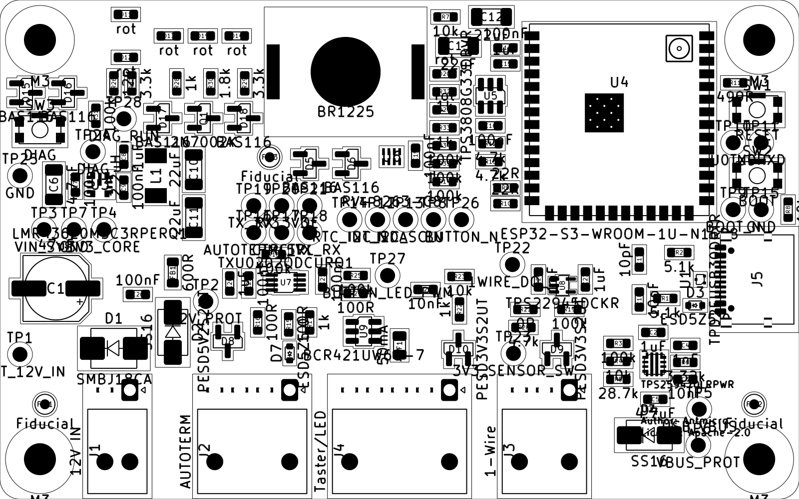
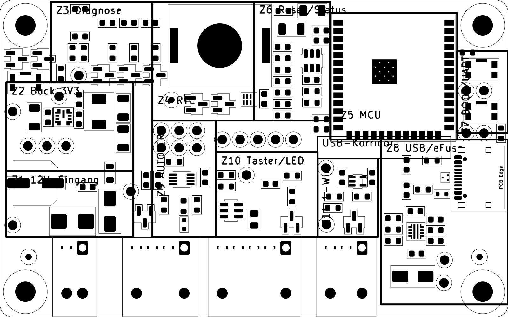
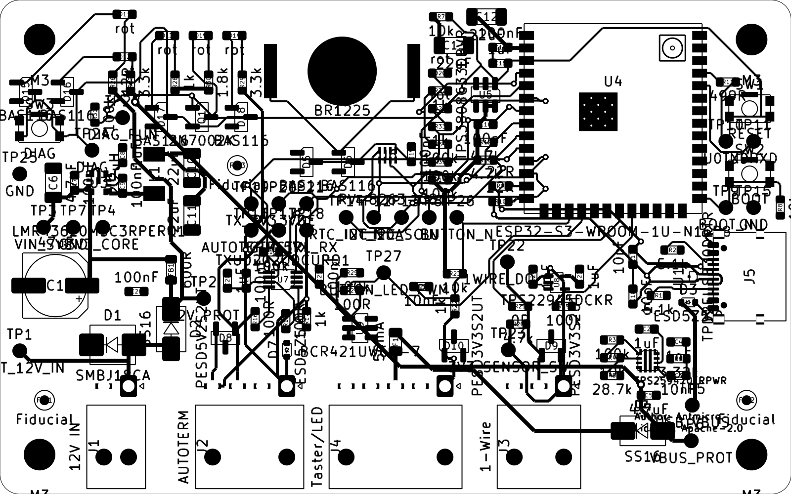

# Platzierung – Schritt 3 bis 5: Platzierung, elektrische Bewertung, Validierung

Stand: 2026-10-14 · Grundlage: [Analyse und Floorplan](Platzierung_1_Analyse_Floorplan.md) (freigegeben), [PCB Layout Engineering Instructions](../docs/PCB_Layout_Engineering_Instructions.md)
Werkzeuge (reproduzierbar, im Repo):
- `tools/place_v2.py`: alle 139 Positionen explizit und kommentiert.
- `tools/check_placement.py`: Platzierungsprüfung.
- `tools/ratsnest_metrics.py`: Ratsnest-Kennzahlen.
- `tools/update_footprints.py`: Footprints aus der Bibliothek aktualisieren.

Vergleichsbasis: Git-Tag `placement-baseline-1`.

Dieser Bericht ist der **Platzierungsmeilenstein**. Geroutet wird erst nach seiner Freigabe.

## 1. Ergebnis

| Kriterium (Abnahme laut Anleitung) | Ergebnis |
|---|---|
| Alle Footprints erfasst | 139 / 139 (132 Bauteile, 4 Befestigungslöcher, 3 Passermarken); jede Position im Skript begründet |
| Mechanische Randbedingungen | Kontur, Löcher, Steckerkante J1/J2/J4/J3, USB-C rechts, U.FL oben, Taster/LEDs/Knopfzelle oben zugänglich |
| Funktionsblöcke räumlich zusammenhängend | ja, nach Floorplan (Abschnitt 3); 3 begründete Abweichungen |
| Abblockung | alle 14 geprüften Kondensatoren 1,4–3,3 mm (Padmitte) vom Pin, Datenblattgrenzen eingehalten |
| Schaltregler nach Referenz | CIN 1,6 mm an VIN/GND, CBOOT/CVCC an ihren Pins, L1 neben SW, COUT am L1-Ausgang, VOUT-Messung von der SW-Seite abgewandt |
| Hochstrom- und HF-Pfade machbar | 12-V-Kette J1→D1/D2→C26→FB1 in Flussrichtung; USB-Paar mit freiem Korridor |
| Empfindliche Signale geschützt | SW-Knoten ≥ 22 mm von RTC, ≥ 33 mm von USB, ≥ 36 mm vom Modul, ≥ 40 mm von 1-Wire |
| Masse- und Rückstromführung | L2 ungeteilt (Y-02); keine Platzierung erzwingt eine Teilung |
| Courtyards und Freiräume | 0 Kollisionen; Lochfreiraum 3,3 mm; Kontur ≥ 0,3 mm |
| Platzierungsbedingte DRC-Fehler | 0 |
| Fertigung und Bestückung | einseitig; Passermarken; gepolte LEDs einheitlich |
| Routing-Engpässe | Fan-out-Streifen vor den Modulpads 4–12 und USB-Korridor frei (geprüft) |

## 2. Rendering

**Bestückung (F.Cu, Bestückungszeichnung, Courtyards):**

**Platzierung über dem freigegebenen Floorplan:**

## 3. Platzierungsentscheidungen und Begründung

| Block | Entscheidung | Begründung / Quelle |
|---|---|---|
| B3 Schaltregler | U3 0°; C7 (100 nF) senkrecht zwischen VIN (Pad 3/4) und GND (Pad 1), C6 (4,7 µF) daneben; C9 zwischen BOOT und SW; C8 an VCC; L1 270° rechts, SW-Pad unten; C10/C11 am L1-Ausgang | LMR43620 8.5.1 und Fig. 8-31/8-32: kleinste Eingangsschleife, kurze CBOOT/CVCC, kleine SW-Fläche; VOUT (Pad 8, oben rechts) wird oben zu C10 geführt, weg vom SW-Knoten unten |
| B1 12-V-Eingang | D1 (TVS) waagrecht direkt über J1, Pad 2 über J1.1, Pad 1 über J1.2 (GND); D2 senkrecht (Anode unten); C26, FB1 und C1 folgen nach oben | Y-06/G-07: Schutz am Stecker mit kurzem GND-Pfad; Energiefluss nach oben zum Schaltregler |
| B2 USB | U1 90° direkt an J5: D+/D− fluchten mit A6/A7 (Durchfluss); D3 an VBUS; R1/R2 an CC1/CC2 beiderseits des Paares; eFuse-Cluster unter J5 mit R3–R5 an EN/OVLO, R6/C3/C4 an ILM/DVDT/ITIMER; D4 als ODER-Diode am unteren Rand | TPD2EUSB30 10.1; TPS25947 8.4.1 (Hilfsbauteile an ihren Pins, ILM fern von Schaltsignalen) |
| B4 MCU | C14 1,9 mm an Pad 2, C12/C13 (22 µF) daneben; R9/R10 1,8 mm an Pad 13/14; R11 2,2 mm an Pad 37 | Espressif PCB Layout Design; WROOM-1U-Datenblatt |
| Fan-out | Streifen x 150,9–152,2 vor den Modulpads 4–12 frei: kurze L1-Stichleitung, Via, weiter auf L3 | 9 langsame Signale (Status, DIAG_RUN, RTC/I2C, AUTOTERM) kommen sonst nur durch 0,2-mm-Spalte heraus; L3 ist für langsame Signale vorgesehen (Y-02) |
| B5 Reset/Boot | RESET (SW1) und BOOT (SW2) nebeneinander am rechten Rand; U5 mit C16 und EN-RC (R7/C15) an Pad 3; EN zu SW1 unter dem Modul auf L3/L4 | Zugänglichkeit (M-08); hält die linke Modulkante für den Fan-out frei; EN langsam, 10 kΩ/1 µF gefiltert |
| B6 RTC | BT1 oben Mitte; U6 mit C19 und D5/D6 im Streifen darunter am rechten Ende | ruhige Zone, 22,5 mm vom SW-Knoten (Y-04) |
| B10 Diagnose | LEDs im Bild nach G-01 (12V und USB übereinander, Zusammenführung zu 3V3 → RUN → HEAT), alle LEDs 0°; Band für Beschriftung und Linien frei; Vorwiderstände in Reihe 1, Dioden und Q1 in Reihe 2; 12V/USB-Dioden und DIAG-Taster links unter H1 | G-01/G-03; einheitliche Ausrichtung (Anleitung Phase 5) |
| B11 Status | D20/D21 mit R32–R35 als Spalte links neben U5 | sichtbar (G-06), außerhalb des Fan-out-Streifens |
| B7 AUTOTERM | D7 und D8 direkt an J2; U7 180° (5-V-Seite unten zum Stecker, 3,3-V-Seite oben zum Modul) mit C20–C22 an VCCA/VCCB | TXU0202 11.1; Y-06. Die Pinfolge des TXU0202 erzwingt eine TX/RX-Kreuzung auf der 5-V-Seite: Sie liegt im RX-Zweig hinter R17 (1 kΩ) als ein Via auf L3 |
| B8 1-Wire | D9 90° mit Pins zu J3.2/J3.1, GND oben; U8 mit C23 (VIN) und C24 (VOUT) direkt am Bauteil | TPS22945 11.1; Y-06 |
| B9 Taster/Ring-LED | D10 an J4.1; F1 im LED-Plus-Pfad zu J4.3; U9 mit freier Fläche um die OUT-Pins | BCR421: Wärme über die OUT-Pins (Kupferfläche im Routing) |
| Testpunkte | blockweise in Reihen: Buck (VIN_SYS, GND, 3V3), AUTOTERM (2 Reihen), MCU (INT, SDA, SCL, EN, BUTTON), UART/BOOT/GND zwischen den Tastern | A16; zugänglich, nicht verstreut |
| Passermarken | (104,5/140,5), (175,5/140,5), (124,0/116,75): unsymmetrisches Dreieck, abseits der Routing-Kanäle (Probelauf, Abschnitt 10) | G-10 |

**Abweichungen vom Floorplan (begründet):**
1. Die 12V/USB-Dioden D15/D16, der DIAG-Taster und R31 liegen links unter H1 außerhalb von Z3. So bleibt das LED-Bild frei für Beschriftung.
2. D8 sitzt im Trennstreifen x 121–124 direkt über J2-Pin 3/4, Schutz am Stecker hat Vorrang.
3. Die MCU-Testpunktreihe nutzt den Streifen zwischen Z6 und Z10.
4. Der Abstand SW-Knoten zu RTC beträgt 22,5 mm statt der geplanten 25 mm. Bewertung: ausreichend für 2,2 MHz, durchgehende GND-Lage L2 dazwischen.

## 4. Kritische Anforderungen – Nachweis (`tools/check_placement.py`)

Abstände Padmitte zu Padmitte.

| Verbindung | Abstand | Quelle |
|---|---|---|
| C7.1 -> U3.4 | 1.57 mm (Grenze 2.5) | LMR43620 8.5.1 CIN an VIN |
| C7.2 -> U3.1 | 1.56 mm (Grenze 2.5) | LMR43620 8.5.1 CIN an GND |
| C8.1 -> U3.7 | 2.29 mm (Grenze 3.0) | LMR43620 8.5.1 CVCC |
| C9.2 -> U3.6 | 1.61 mm (Grenze 3.0) | LMR43620 8.5.1 CBOOT an BOOT |
| C9.1 -> U3.5 | 1.52 mm (Grenze 3.0) | LMR43620 8.5.1 CBOOT an SW |
| L1.1 -> U3.5 | 4.71 mm (Grenze 5.5) | LMR43620 8.5.1 SW-Fläche klein |
| C14.1 -> U4.2 | 1.88 mm (Grenze 2.5) | Espressif: 100 nF am 3V3-Pin |
| C15.1 -> U4.3 | 1.89 mm (Grenze 3.0) | WROOM-1U: EN-RC |
| C16.1 -> U5.5 | 2.02 mm (Grenze 3.0) | TPS3808 8.4.1 |
| C19.1 -> U6.5 | 1.98 mm (Grenze 3.0) | RTC VDD |
| C21.1 -> U7.3 | 2.41 mm (Grenze 3.0) | TXU0202 11.1 VCCA |
| C22.1 -> U7.7 | 2.38 mm (Grenze 3.0) | TXU0202 11.1 VCCB |
| C23.1 -> U8.5 | 1.68 mm (Grenze 3.0) | TPS22945 11.1 VIN |
| C24.1 -> U8.1 | 1.77 mm (Grenze 3.0) | TPS22945 11.1 VOUT |
| C2.1 -> U2.5 | 3.26 mm (Grenze 3.5) | TPS25947 8.4.1 IN-Kondensator |
| R6.1 -> U2.9 | 1.38 mm (Grenze 3.5) | TPS25947 8.4.1 RILM nah |
| C3.1 -> U2.7 | 1.72 mm (Grenze 3.5) | TPS25947 8.4.1 CdVdT nah |
| R9.1 -> U4.13 | 1.82 mm (Grenze 2.5) | Espressif: USB-R am Modul |
| R10.1 -> U4.14 | 1.85 mm (Grenze 2.5) | Espressif: USB-R am Modul |
| R11.1 -> U4.37 | 2.22 mm (Grenze 3.5) | Espressif: UART-R am Modul |
| U1.1 -> J5.A6 | 1.60 mm (Grenze 2.5) | TPD2EUSB30 10.1 am Stecker |
| U1.2 -> J5.A7 | 1.60 mm (Grenze 2.5) | TPD2EUSB30 10.1 am Stecker |
| D3.1 -> J5.A4 | 3.23 mm (Grenze 6.0) | Y-06 VBUS-ESD am Stecker |
| D1.2 -> J1.1 | 4.21 mm (Grenze 5.0) | Y-06 TVS am Stecker |
| D7.1 -> J2.1 | 2.97 mm (Grenze 5.0) | Y-06 ESD am Stecker |
| D8.1 -> J2.3 | 5.81 mm (Grenze 6.5) | Y-06 ESD am Stecker |
| D8.2 -> J2.4 | 5.82 mm (Grenze 6.5) | Y-06 ESD am Stecker |
| D9.1 -> J3.2 | 3.15 mm (Grenze 5.0) | Y-06 ESD am Stecker |
| D9.2 -> J3.1 | 3.15 mm (Grenze 5.0) | Y-06 ESD am Stecker |
| D10.1 -> J4.1 | 3.13 mm (Grenze 5.0) | Y-06 ESD am Stecker |

| Trennung vom SW-Knoten (L1 Pad 1) | Abstand |
|---|---|
| SW-Knoten -> U6 (RTC) | 22.5 mm (min 20.0) |
| SW-Knoten -> U1 (USB-ESD) | 54.3 mm (min 25.0) |
| SW-Knoten -> R9 (USB-R) | 33.5 mm (min 25.0) |
| SW-Knoten -> U8 (1-Wire) | 40.0 mm (min 25.0) |
| SW-Knoten -> D9 (1-Wire-ESD) | 40.7 mm (min 25.0) |
| SW-Knoten -> U4 (Modul) | 36.6 mm (min 25.0) |

## 5. Elektrische Bewertung (Schritt 4)

| Kriterium | Bewertung |
|---|---|
| Stromschleifen | Buck-Eingangsschleife C7–U3: Pads 1,6 mm vom Pin; SW-Knoten 4,7 mm (U3.5 → C9 → L1); Ausgangsschleife über C10/C11 und L2-GND |
| Rückstrompfade | Alle schnellen Signale auf L1 über ungeteilter L2-GND; USB-Paar ohne Lagenwechsel möglich; langsame Signale kreuzen den USB-Korridor auf L3 (freigegeben) |
| Ratsnest | 144 Luftlinien, 911 mm, 96 Kreuzungen (ohne GND/3V3/VIN_SYS). Die Vergleichsbasis hatte 746 mm und 59 Kreuzungen, weil sie auf Länge optimiert war. Der Zuwachs stammt aus bewussten, langsamen Verbindungen: Diagnoseanzeige links oben (VBUS_PROT, 12V_PROT, AUTOTERM_5V, DIAG_RUN), EN zum RESET-Taster, Testpunktreihen. Kein kritisches Signal betroffen. |
| Wärme | U3 ≈ 0,3 W (RθJA 50–84 °C/W → +15…25 K), U9 ≤ 0,13 W, D2 ≈ 0,1 W; Knopfzelle ≥ 20 mm vom Schaltregler, 10 mm vom Modul |
| Routing-Machbarkeit | Fan-out-Streifen und USB-Korridor frei (Prüfung); keine Kanäle schmaler als 1,2 mm in kritischen Bereichen |

## 6. Gefundene Probleme und Korrekturen

| # | Problem | Korrektur |
|---|---|---|
| K-01 | Erster Entwurf: BAS116 direkt über der LED-Reihe, kein Platz für G-01-Beschriftung | Diagnosebereich neu geordnet: LED-Bild frei, Unterbau in zwei Reihen darunter |
| K-02 | Bauteile direkt vor den Modulpads 4–12 (Routing-Engpass, Signale nur durch 0,2-mm-Spalte) | Fan-out-Streifen freigehalten, RESET-Taster an den rechten Rand, U5/C16/R12/R13 nach links |
| K-03 | Courtyard-Kollisionen D4/TP5, D9/R20, BT1/SW1, D18/Q1, D15/D16 mit H1 | Positionen korrigiert, Prüfung ohne Befund |
| K-05 | Passermarke FID3 lag in einem Routing-Kanal (AUTOTERM, 3V3): Freiraum 0,6 mm und Maskenöffnung verletzt (Probelauf 1) | FID3 nach (124,0/116,75) an eine Stelle ohne Leiterbahnverkehr |
| K-04 | 38 Footprints mit Rundungsabweichungen von 1 nm zur Bibliothek (DRC lib_footprint_mismatch) | aus der Bibliothek neu geladen; Pads, Netze, Felder und Schaltplanbezug nachweislich unverändert. U4 und J5 tragen jetzt die Bibliotheks-Montageart „SMD“ |

## 7. DRC (Projektregeln, mit Schaltplan-Parität)

| Kategorie | Anzahl | Einordnung |
|---|---:|---|
| unconnected_items (Fehler) | 251 | erwartet, Routing (Schritt 6) |
| Fehler sonst | 0 | – |
| silk_overlap / silk_over_copper / silk_edge_clearance (Warnung) | 90 / 93 / 5 | Beschriftung, nicht platzierungsbedingt; siehe Entscheidung E-02 |
| text_height (Warnung) | 1 | Referenz von U2 (Footprint-Vorgabe); mit E-02 |
| footprint_filters_mismatch (Parität, Warnung) | 1 | F1, begründet in Phase 2 |

Vollständiger Bericht: `output/drc.rpt` (wird nicht versioniert, mit dem Befehl aus der README reproduzierbar).

## 8. Restrisiken und offene Entscheidungen

| # | Punkt |
|---|---|
| E-02 | **Bestückungsdruck – entschieden 2026-10-14:** Referenzbezeichner nur auf der Bestückungszeichnung (F.Fab). Der Silkscreen trägt die Y-08-Inhalte: Steckerbezeichnungen und Pin 1, Polaritäten, Batteriepolung, RESET/BOOT/DIAG, Status-LEDs, Energiefluss-Bild, Revision, Testpunktnamen. Umsetzung nach dem Routing-Probelauf. |
| R-01 | Ratsnest-Kreuzungen langsamer Diagnose-/Steuerleitungen erfordern Lagenwechsel auf L3/L4. Akzeptiert, Machbarkeit im Routing zu bestätigen. |
| R-02 | Routbarkeits-Probelauf mit Freerouting 2.1.0 auf einer Kopie: beauftragt 2026-10-14, Ergebnis siehe Abschnitt 10. |
| R-03 | U4/J5 als „SMD“ in der Bestückungsdatei; THT-Schirmlaschen von J5 bei der JLCPCB-Bestellung prüfen (Phase 5). |
| R-04 | C1 (Elko) und BT1 sind die schwersten Teile. C1 liegt ≈ 17 mm von H3; Befestigung gegen Vibration (M-03) bei Bedarf mit Kleber. |

## 9. Freigabekriterien Platzierungsmeilenstein

- [x] Funktionsblöcke und Floorplan (Schritt 1–2, freigegeben)
- [x] Hierarchische Platzierung, reproduzierbar (Schritt 3)
- [x] Elektrische Bewertung (Schritt 4)
- [x] Validierung: Platzierungsprüfung, DRC, Parität (Schritt 5)
- [x] Rendering und Positionstabelle
- [x] Entscheidung E-02 (Bestückungsdruck): Referenzen auf F.Fab, Silkscreen nach Y-08
- [x] Routbarkeits-Probelauf (Abschnitt 10)
- [ ] Freigabe durch Auftraggeber → danach Routing (Schritt 6)

## 10. Routbarkeits-Probelauf (Freerouting 2.1.0, nur Bewertung)

Der Probelauf läuft auf einer Kopie und dient nur der Bewertung der Platzierung, nicht als Layout. Freerouting 2.1.0 von `github.com/freerouting/freerouting` ist die letzte Version für Java 21.

**Aufbau:**
- L2 als GND-Ebene (Lagentyp „power“), damit keine Signale auf L2 laufen.
- Abstand 0,2 mm (USB 0,15 mm), strenger als die Netzklassen.
- Versorgungsnetze 0,4 mm statt 0,65 mm, als Ersatz für Einschnürungen an Feinraster-Pins.
- Auftragszeitlimit 5 min.
- Bewertung mit den echten Projektregeln (`.kicad_dru`).

| Kennzahl | Lauf 1 | Lauf 2 (FID3 verschoben, Versorgung 0,4 mm) |
|---|---|---|
| Verletzungen der Projektregeln | 6 (alle an FID3) | **0** |
| Vias | 21 | 31 |
| offene Verbindungen gesamt | 102 | 82 |
| davon Versorgungs-/Flächennetze | 99 | 79 (GND 60, 3V3 11, VBUS 5, VIN_SYS, 12V_PROT, VBUS_PROT je 1) |
| davon Signale | 1 | 3 (U2-ILM 1,4 mm, U2-ITIMER 1,9 mm, LED_PWM_MINUS 6 mm) |

**Bewertung:**
- **Signale:** Alle Signale bis auf drei kurze Verbindungen wurden geroutet, fast vollständig auf L1. Die drei offenen Signalverbindungen sind gerade, freie Strecken an den VQFN-HR-Sonderpads der eFuse bzw. am THT-Pad von J4. Freerouting kann dort mit fester Breite nicht einschnüren; von Hand sind sie trivial.
- **Flächennetze:** Freerouting bindet SMD-Pads nicht selbst an die Ebenen an. Nachweis der Machbarkeit mit `tools/check_plane_vias.py`: **alle 107 Pads** von GND, 3V3_CORE und VIN_SYS haben Platz für ein eigenes Via (0,6/0,3 mm, kein Via-in-Pad, 0,2 mm zu fremden Netzen) innerhalb von 1,2 mm.
- **Fazit:** Die Platzierung ist routbar. Engpässe gab es nur an FID3 (behoben).

## Anhang: Positionen (exakt, aus der Leiterplatte)

| Block | Ref | Wert | x mm | y mm | Drehung |
|---|---|---|---:|---:|---:|
| B1 12-V-Eingang | C1 | 47uF | 105.60 | 128.90 | 180° |
|  | C26 | 100nF | 113.80 | 129.50 | 180° |
|  | D1 | SMBJ18CA | 111.40 | 134.90 | 0° |
|  | D2 | SS16 | 117.30 | 133.30 | 270° |
|  | FB1 | 600R | 117.30 | 127.30 | 90° |
|  | J1 | 12V IN | 113.00 | 139.07 | 270° |
|  | TP1 | BATT_12V_IN | 102.00 | 135.50 | 0° |
|  | TP2 | 12V_PROT | 120.60 | 130.20 | 0° |
|  | TP7 | GND | 107.40 | 123.00 | 0° |
| B2 USB-Eingang | C2 | 1uF | 165.40 | 133.30 | 0° |
|  | C3 | 10nF | 168.60 | 138.00 | 0° |
|  | C4 | 1nF | 168.60 | 134.60 | 0° |
|  | C5 | 4.7uF | 165.60 | 140.00 | 0° |
|  | C17 | 10pF | 164.00 | 126.00 | 270° |
|  | C18 | 10pF | 164.00 | 130.00 | 90° |
|  | D3 | ESD5Z5.0 | 169.60 | 130.60 | 0° |
|  | D4 | SS16 | 165.00 | 143.60 | 0° |
|  | J5 | USB4105-GF-A-060 | 175.80 | 128.00 | 90° |
|  | R1 | 5.1k | 166.60 | 129.90 | 0° |
|  | R2 | 5.1k | 168.00 | 125.30 | 0° |
|  | R3 | 100k | 161.90 | 134.40 | 0° |
|  | R4 | 10k | 161.90 | 136.20 | 0° |
|  | R5 | 28.7k | 161.90 | 138.00 | 0° |
|  | R6 | 3.32k | 168.60 | 136.30 | 0° |
|  | TP5 | USB_VBUS | 170.00 | 141.00 | 0° |
|  | TP6 | VBUS_PROT | 169.90 | 144.60 | 0° |
|  | TP15 | GND | 176.20 | 121.00 | 0° |
|  | U1 | TPD2EUSB30DRTR | 170.10 | 128.00 | 90° |
|  | U2 | TPS259470LRPWR | 165.50 | 136.50 | 0° |
| B3 Schaltregler | C6 | 4.7uF | 105.40 | 118.50 | 90° |
|  | C7 | 100nF | 107.55 | 118.50 | 90° |
|  | C8 | 1uF | 112.40 | 115.70 | 90° |
|  | C9 | 100nF | 112.40 | 118.80 | 90° |
|  | C10 | 22uF | 119.40 | 117.00 | 270° |
|  | C11 | 22uF | 119.40 | 121.80 | 270° |
|  | L1 | 2.2uH | 115.60 | 117.60 | 270° |
|  | TP3 | VIN_SYS | 104.40 | 123.00 | 0° |
|  | TP4 | 3V3_CORE | 110.40 | 123.00 | 0° |
|  | U3 | LMR43620MSC3RPERQ1 | 110.00 | 118.50 | 0° |
| B4 MCU | C12 | 22uF | 149.20 | 101.70 | 0° |
|  | C13 | 22uF | 145.90 | 104.60 | 0° |
|  | C14 | 100nF | 150.60 | 104.80 | 180° |
|  | R9 | 22R | 150.60 | 118.83 | 180° |
|  | R10 | 22R | 150.60 | 120.40 | 180° |
|  | R11 | 499R | 173.60 | 108.30 | 0° |
|  | TP10 | U0TXD | 173.40 | 114.30 | 0° |
|  | TP11 | U0RXD | 176.20 | 114.30 | 0° |
|  | U4 | ESP32-S3-WROOM-1U-N16R8 | 162.00 | 112.00 | 0° |
| B5 Reset/Boot | C15 | 1uF | 150.60 | 106.40 | 180° |
|  | C16 | 100nF | 149.10 | 112.60 | 0° |
|  | R7 | 10k | 144.60 | 101.70 | 0° |
|  | R8 | 10k | 178.90 | 121.00 | 90° |
|  | SW1 | RESET | 175.80 | 111.00 | 0° |
|  | SW2 | BOOT | 175.80 | 117.60 | 0° |
|  | TP8 | EN | 143.40 | 122.00 | 0° |
|  | TP9 | BOOT_N | 173.40 | 121.00 | 0° |
|  | U5 | TPS3808G33DBVR | 149.10 | 109.60 | 270° |
| B6 RTC | BT1 | BR1225 | 134.60 | 107.20 | 0° |
|  | C19 | 100nF | 141.60 | 115.60 | 90° |
|  | D5 | BAS116 | 131.00 | 116.40 | 0° |
|  | D6 | BAS116 | 135.20 | 116.40 | 0° |
|  | R12 | 4.7k | 149.10 | 114.40 | 0° |
|  | R13 | 4.7k | 149.10 | 116.20 | 0° |
|  | R14 | 100k | 144.50 | 118.20 | 0° |
|  | TP12 | I2C_SDA | 137.80 | 122.00 | 0° |
|  | TP13 | I2C_SCL | 140.60 | 122.00 | 0° |
|  | TP14 | RTC_INT_N | 135.00 | 122.00 | 0° |
|  | U6 | RV-8263-C8 | 139.20 | 115.70 | 0° |
| B7 AUTOTERM | C20 | 1uF | 123.00 | 128.40 | 90° |
|  | C21 | 100nF | 132.30 | 128.00 | 90° |
|  | C22 | 100nF | 124.90 | 128.40 | 90° |
|  | D7 | ESD5Z5.0 | 129.00 | 135.40 | 90° |
|  | D8 | PESD5V2S2UT | 122.80 | 134.20 | 270° |
|  | J2 | AUTOTERM | 129.00 | 139.07 | 270° |
|  | R15 | 100R | 128.90 | 132.50 | 90° |
|  | R16 | 100R | 125.80 | 132.30 | 90° |
|  | R17 | 1k | 131.00 | 132.30 | 90° |
|  | R18 | 100k | 127.40 | 125.50 | 0° |
|  | TP16 | AUTOTERM_5V | 125.40 | 123.30 | 0° |
|  | TP17 | CTRL_TX | 128.20 | 123.30 | 0° |
|  | TP18 | CTRL_RX | 131.00 | 123.30 | 0° |
|  | TP19 | TX_3V3 | 125.40 | 120.60 | 0° |
|  | TP20 | RX_3V3 | 128.20 | 120.60 | 0° |
|  | TP21 | OE | 131.00 | 120.60 | 0° |
|  | U7 | TXU0202QDCURQ1 | 128.60 | 128.30 | 180° |
| B8 1-Wire | C23 | 1uF | 158.60 | 128.00 | 90° |
|  | C24 | 1uF | 153.90 | 128.00 | 90° |
|  | D9 | PESD3V3S2UT | 155.75 | 135.00 | 90° |
|  | J3 | 1-Wire | 157.00 | 139.07 | 270° |
|  | R19 | 100k | 157.00 | 131.00 | 0° |
|  | R20 | 4.7k | 152.40 | 132.80 | 0° |
|  | R21 | 0R | 152.60 | 131.00 | 0° |
|  | TP22 | 1WIRE_DQ_C | 151.30 | 126.50 | 0° |
|  | TP23 | 3V3_SENSOR_SW | 151.40 | 135.40 | 0° |
|  | U8 | TPS22945DCKR | 156.30 | 128.60 | 0° |
| B9 Taster/Ring-LED | C25 | 10nF | 142.60 | 129.00 | 0° |
|  | D10 | PESD3V3S2UT | 145.90 | 135.00 | 90° |
|  | F1 | 50mA | 140.00 | 134.60 | 270° |
|  | J4 | Taster/LED | 145.00 | 139.07 | 270° |
|  | R22 | 1k | 146.00 | 131.00 | 270° |
|  | R23 | 10k | 146.00 | 127.70 | 0° |
|  | R24 | 100R | 135.60 | 129.40 | 0° |
|  | R25 | 100k | 135.60 | 127.60 | 0° |
|  | TP26 | BUTTON_N | 146.20 | 122.00 | 0° |
|  | TP27 | BUTTON_LED_PWM | 138.80 | 127.60 | 0° |
|  | U9 | BCR421UW6Q-7 | 136.40 | 133.20 | 0° |
| B10 Diagnose | D11 | rot | 112.60 | 101.45 | 0° |
|  | D12 | rot | 112.60 | 105.75 | 0° |
|  | D13 | rot | 116.90 | 103.60 | 0° |
|  | D14 | rot | 123.70 | 103.60 | 0° |
|  | D15 | BAS116 | 102.60 | 109.30 | 0° |
|  | D16 | BAS116 | 106.80 | 109.30 | 0° |
|  | D17 | BAS116 | 116.30 | 111.85 | 0° |
|  | D18 | BAS116 | 124.40 | 111.85 | 0° |
|  | D19 | rot | 120.30 | 103.60 | 0° |
|  | Q1 | 2N7002K | 120.40 | 111.85 | 0° |
|  | R26 | 12k | 111.40 | 108.35 | 90° |
|  | R27 | 3.3k | 113.20 | 108.35 | 90° |
|  | R28 | 1k | 117.70 | 108.35 | 90° |
|  | R29 | 3.3k | 124.50 | 108.35 | 90° |
|  | R30 | 1.8k | 121.10 | 108.35 | 90° |
|  | R31 | 100k | 109.60 | 111.60 | 90° |
|  | SW3 | DIAG | 104.00 | 113.00 | 0° |
|  | TP24 | DIAG | 109.30 | 115.20 | 0° |
|  | TP25 | GND | 102.00 | 117.60 | 0° |
|  | TP28 | DIAG_RUN | 112.40 | 111.90 | 0° |
| B11 Status | D20 | rot | 144.50 | 107.40 | 180° |
|  | D21 | rot | 144.50 | 111.00 | 180° |
|  | R32 | 1k | 144.50 | 109.20 | 0° |
|  | R33 | 1k | 144.50 | 112.80 | 0° |
|  | R34 | 100k | 144.50 | 114.60 | 0° |
|  | R35 | 100k | 144.50 | 116.40 | 0° |
| Mechanik | FID1 | Fiducial | 104.50 | 140.50 | 0° |
|  | FID2 | Fiducial | 175.50 | 140.50 | 0° |
|  | FID3 | Fiducial | 124.00 | 116.75 | 0° |
|  | H1 | M3 | 104.00 | 104.00 | 0° |
|  | H2 | M3 | 176.00 | 104.00 | 0° |
|  | H3 | M3 | 104.00 | 146.00 | 0° |
|  | H4 | M3 | 176.00 | 146.00 | 0° |
