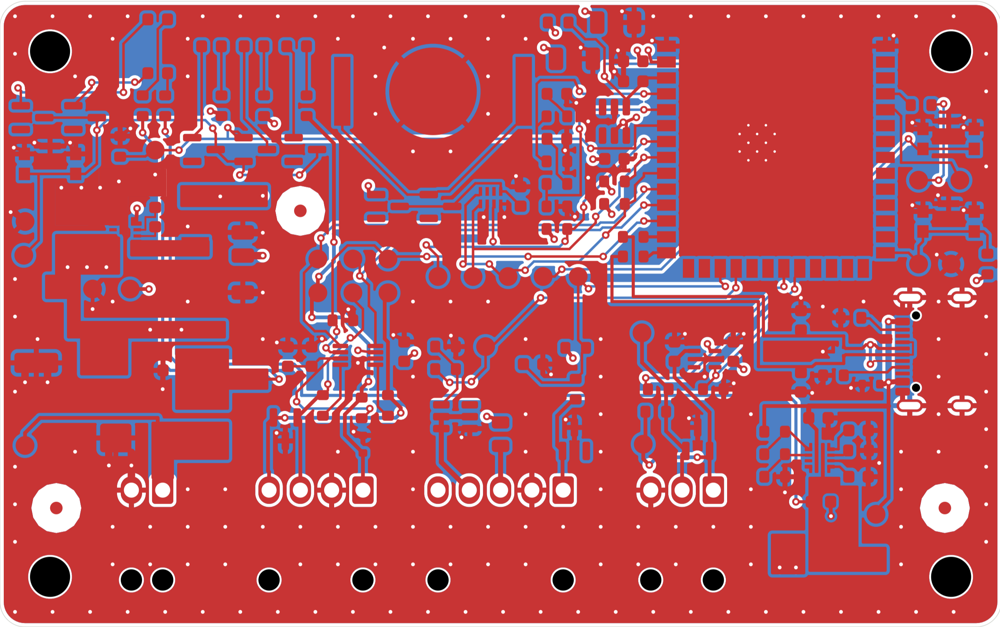
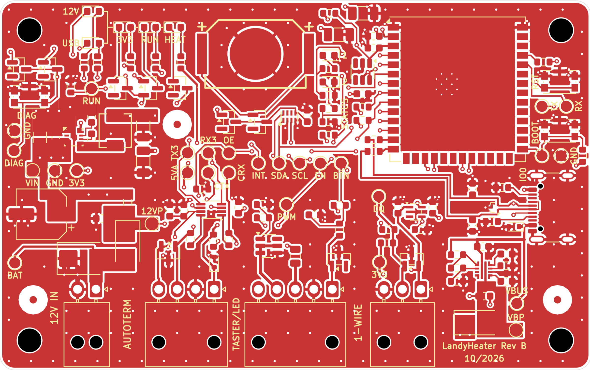
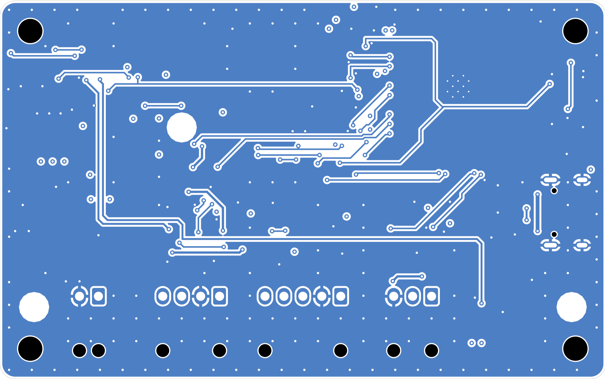
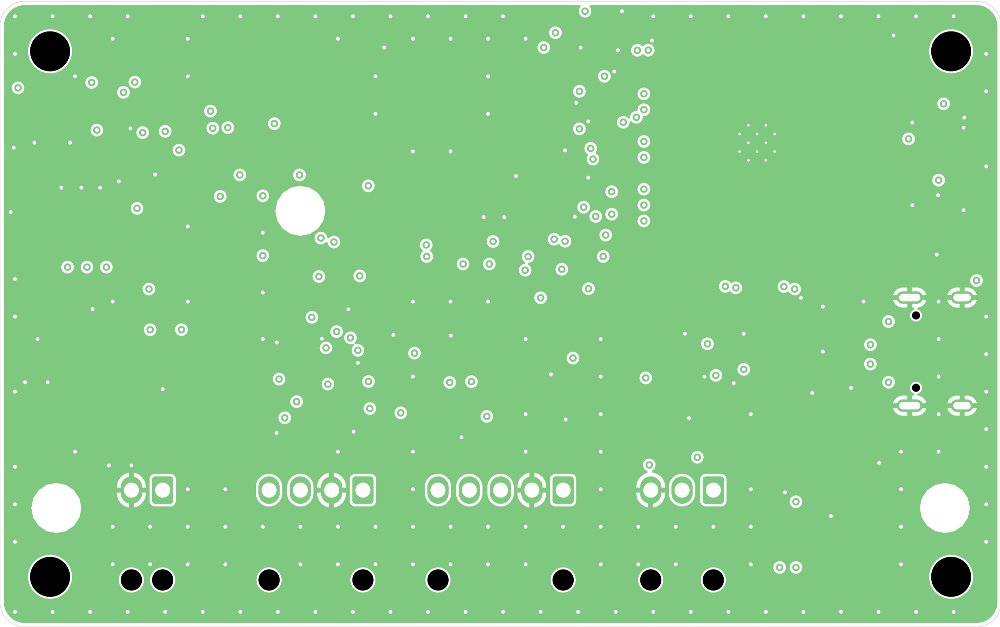
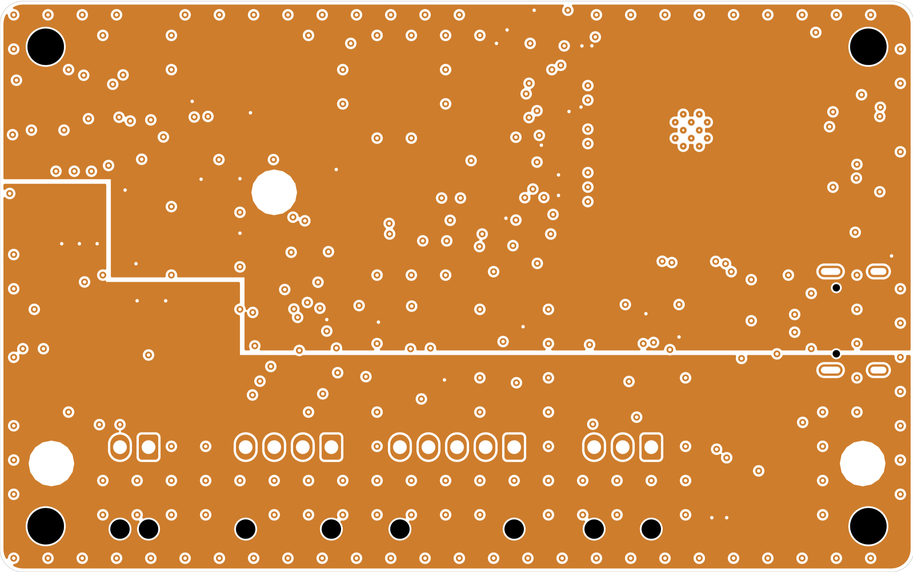
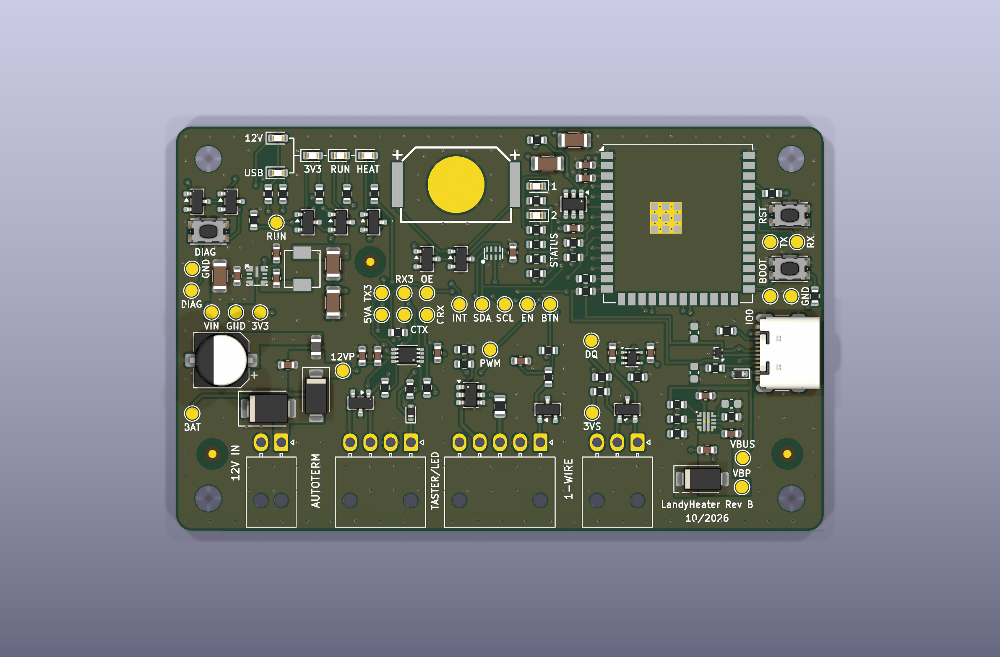
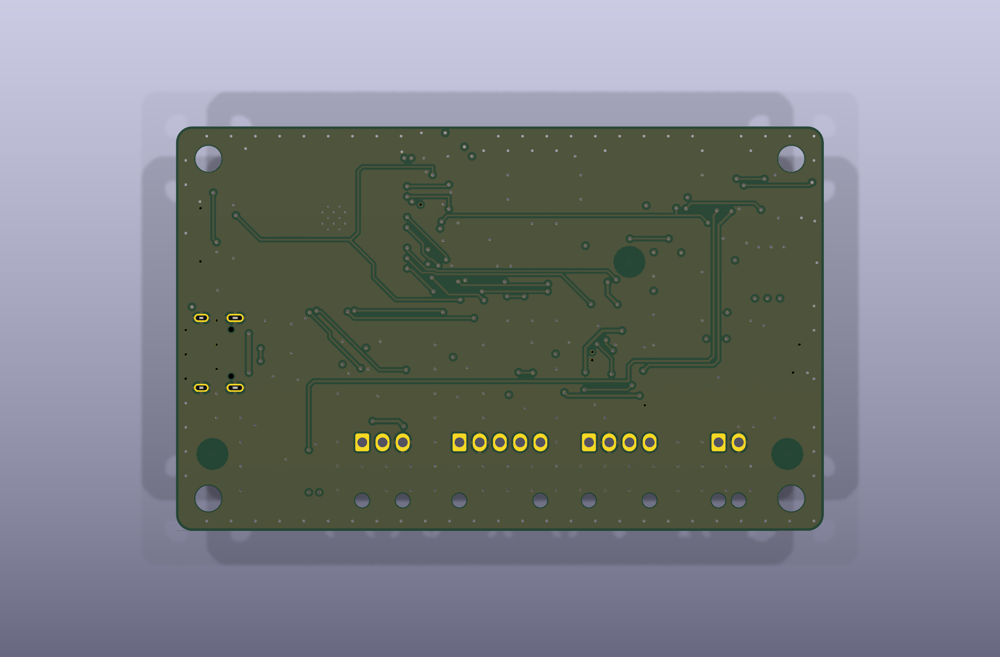

# Schritt 6 – Routing (hybrid)

Freigegeben: Platzierung („that looks good, I approve. Please continue with step 6"); Methode Hybrid:
kritische Pfade von Hand (reproduzierbar per Skript), langsame Signale mit Freerouting bei fixierten Handrouten,
danach Durchsicht/Nacharbeit und DRC.

Werkzeuge (KiCad-Python, Board im Projektordner, Projektdatei-Schutz wie in CLAUDE.md):

```
python3 tools/place_v2.py     LandyHeater.kicad_pcb
python3 tools/route_manual.py LandyHeater.kicad_pcb   # Handrouten + R:-Flächen, füllt Innenlagen
python3 tools/silkscreen.py   LandyHeater.kicad_pcb
```

## 6.3 Handrouting – Stand


| Block | Inhalt | Datenblatt / Regel |
|---|---|---|
| A 12-V-Eingang | BATT-Fläche J1 → D1 (TVS direkt am Pin) → D2; 12V_PROT-Fläche zu C26/FB1; TP1-Abgriff über D1; GND-Vias an D1/C26/C1 | Y-06, V-01 |
| B Schaltregler U3 | VIN-Fläche über C6/C7 und U3-VIN/GND, kleine SW-Fläche U3 → L1, BOOT/VCC 0,15 mm kurz, FB-Abgriff (VOUT-Sense) abseits von SW, 3V3-Fläche C10/C11 mit Vias zu L3 | LMR43620 8.5.1 |
| C USB-C | D+: B6↔A6 per Schleife hinter den Padenden (kein Via); D−: B7 einziger Lagenwechsel (B.Cu-Brücke, 2 Vias); Paar über U1 (Durchfluss, GND-Via direkt an Pin 3); C17/C18 (DNP) mit dem Signalpad direkt auf der Leitung (stubfrei); Paar ohne weiteren Lagenwechsel über ungeteilter L2-GND zu R9/R10 am Modul; CC1/CC2 zu R1/R2 mit eigenen GND-Vias; VBUS oben/unten über B.Cu verbunden, D3 direkt an den unteren VBUS-Pads | TPD2EUSB30 10.1, Espressif, Y-03 |
| D eFuse U2 | ILM/DVDT/ITIMER direkt zu R6/C3/C4; EN/OVLO-Teiler R3–R5 an Pin 1/2; lokale GND-Insel (Pin 8, C2/C3/C4/R6) mit einem Sternpunkt-Via zu L2; OUT als VBUS_PROT-Fläche mit C5, D4-Anode, TP6; D4-Kathode als VIN-Fläche mit 2 Vias zu L3 | TPS25947 8.4.1 |

DRC (Projektboard, alle Schweregrade): **0 Verletzungen**; Parität: 1 Warnung (F1 Footprint-Filter PTC,
offener Punkt Phase 5). Offene Verbindungen: 168 – überwiegend Flächenpads ohne Via (GND, 3V3) und langsame
Signale (Freerouting).

### Routingbedingte Änderungen an der freigegebenen Platzierung (USB-Block)

Beim Entflechten des USB-Steckers zeigte sich, dass das Paar am Stecker genau eine Kreuzung braucht und C17/C18
nur stubfrei anschließen, wenn sie direkt auf der Leitung liegen. Deshalb:

| Bauteil | vorher | jetzt | Grund |
|---|---|---|---|
| U1 | (170,1; 128,0; 90°) | (167,0; 128,0; 90°) | Platz für D+-Schleife und D−-Brücke zwischen J5 und U1; U1 jetzt 4,1 mm vor den J5-Pads, Prüfgrenze von 2,5 auf 5,0 mm angepasst (TPD2EUSB30 10.1: „so nah wie möglich") |
| D3, R1, R2 | 0° | 180° | VBUS-/CC-Pad zur Steckerseite, GND-Pad nach innen |
| C17 / C18 | (164,0; 126,0; 270°) / (164,0; 130,0; 90°) | (164,0; 125,5; 90°) / (164,0; 130,45; 270°) | Signalpad berührt die D−/D+-Leitung, kein Stich; GND-Pad nach außen zum Via |
| R6, C4 | y 136,3 / 134,6 | y 135,9 / 134,3 | GND-Pin 8 frei nach rechts zum Sternpunkt, ILM gerade aus Pin 9 |

Prüfung `tools/check_placement.py`: keine Fehler (Sperrkorridor „USB-Paar zu U1" ergänzt).

### Abweichung USB-Paarabstand

Geplant war 0,25/0,13 mm (≈ 89–90 Ω). Die Netzklasse USB hat Abstand 0,15 mm; KiCad nimmt den größeren Wert,
die Regel „USB-Paar 0,13" in `LandyHeater.kicad_dru` greift daher nicht. Statt die Netzklasse zu lockern wird das
Paar mit 0,25/0,15 mm geführt (≈ 92 Ω, abzugleichen mit dem JLCPCB-Rechner, P3-03). Für USB Full Speed (12 Mbit/s)
ist das unkritisch (USB 2.0: 90 Ω ± 15 %).

### 6.3 Fortsetzung – Engstellen von Hand (Blöcke E–G)

| Block | Inhalt | Grund |
|---|---|---|
| E | U7 (VSSOP, 0,5 mm): GND/3V3-Innenpins unter den Gehäusekörper (1,55 mm Reihenabstand) zu je einem Via; U8.2 (SOT-23-5) zwischen Pin 3/4 nach unten zum Via | kein Platz für Vias neben den Innenpins |
| F | Linke Modul-Pinreihe: EN direkt C15.1 → U5.1 (Gasse zwischen C15 und U5); STATUS_LED_1/2 über L4 zu Landungs-Vias, dann auf L1 an die LED-Spalte; DIAG_RUN auf L1 unter U5 hindurch zum Via; SDA/SCL-Pull-ups R12/R13 in der Gasse vor der Via-Spalte; Fan-out-Vias (x 151,45) für RTC_INT, AUTOTERM TX/RX/OE, 1WIRE_DQ (Pin 21) | Freerouting findet im Streifen zwischen Modul und U5/C16/R12/R13 keinen Weg (Probeläufe 13–100 offen) |
| H | Lange L4-Trassen: DIAG_RUN (y 111,0) zu TP28/R31 mit Abzweig zu Q1; 12V_PROT und VBUS_PROT parallel (x 113,0/113,6) zu R26/R27, VBUS_PROT auf y 131,5 innerhalb der VIN-Hälfte von L3 | Freerouting schafft lange Verbindungen mit Lagenwechsel nicht |
| G | Ausgänge der Diagnose-Zuleitungen 12V_PROT/VBUS_PROT mit Via außerhalb ihrer Netzflächen | Rest auf L4 (statisch, ~1 mA; Ausnahme zu Y-03) |

Routingbedingte Platzierungsänderung: **R33 ↔ R34 getauscht.** Vorher wechselten sich die beiden Status-LED-Netze
in der Widerstandsspalte ab (R32 LED1, R33 LED2, R34 LED1, R35 LED2) – jede Lagenzuordnung erzwang Kreuzungen mit den
DIAG/RTC/I2C-Leitungen. Jetzt liegen je Netz die Pads untereinander; D21 erreicht R33.2 unter dem R34-Körper.

## 6.4 Flächenanbindung

`tools/route_planevias.py`: jedes SMD-Pad von GND/3V3_CORE/VIN_SYS ohne Verbindung zu seiner Ebene bekommt ein
Via mit kurzer Bahn (0,6/0,3 mm, kein Via-in-Pad, 0,2 mm zu fremdem Kupfer aller Lagen, L3-Teilung beachtet:
3V3-/VIN-Vias nur über ihrer Teilfläche; keine Vias unter dem Modulkörper; unter der Knopfzelle nur GND).
Ergebnis: alle Flächenpads angebunden (59 Vias, Rest über Handrouting).

## 6.5 Freerouting (langsame Signale)

`tools/freeroute.py` (Hand- und Flächenrouting gesperrt; Arbeitskopie in `build/freeroute`):

- Netzflächen „R: …" zusätzlich als Sperrflächen exportiert – Freerouting 2.1.0 behandelt DSN-Flächen auf Signallagen
  als durchlässig (Probe: 12V_PROT und DIAG_K quer durch die Reglerflächen, SW-Fläche zerteilt).
- L3 als Versorgungslage exportiert (kein Routing auf der geteilten Ebene).
- Viakosten 8 statt 50 (mit 50 meidet Freerouting L4 fast ganz); mehrere Läufe nacheinander, bester wird übernommen;
  harte Zeitgrenze je Lauf (ein Durchgang lief einmal 34 min); Nutzungsstatistik von Freerouting abgeschaltet.
- Übernahme nur neuer Bahnen auf offenen Signalnetzen (keine Zusätze auf Flächennetzen und fertig geroutenen Netzen).

Übernommen wurde der beste Lauf (23 offene Verbindungen) als Ausgangsstand für die Nacharbeit.

## 6.6 Nacharbeit – restliche Verbindungen

`tools/route_finish.py` läuft nach Freerouting und enthält:

| Bereich | Maßnahme |
|---|---|
| RESET/BOOT, UART-Testpunkte | RXD auf L1 in der Gasse zwischen Modulpads und SW1 zu TP11; TXD über L4 zu TP10; BOOT_N U4.27 → TP9; je Taster die beiden Pin-2-Pads verbunden |
| EN | Freerouting hatte EN auf L1 unter dem Modul mit Via unter dem Modulkörper geführt → entfernt; EN jetzt über ein Via bei C15 auf L4 an der Modul-Oberkante entlang zu SW1 und zur TP8-Trasse |
| Diagnose-LEDs, DIAG-Taster | D19-A gerade; D20-A durch die Gasse D20/R32 (LED1 kommt dafür von links an R32/R34); DIAG_K-Gruppen über L4 oberhalb der 12V/VBUS-Trassen verbunden |
| U6 (RTC) | GND-Vias von Pin 2/4 schräg nach außen, damit RTC_INT (Pin 3) gerade nach unten zur L4-Trasse kommt |
| U7 (TXU0202) | Freerouting-Abschnitt von CTRL_TX vor den linken U7-Pins entfernt (sperrte OE und AUTOTERM_5V_F ein) und neu verlegt |
| Rest | `tools/maze_route.py`: deterministischer A*-Router (L1/L4, 45°, 0,1-mm-Raster, für das 0,5-mm-Pinraster von U7 ein Fenster mit 0,05 mm), gleiche Abstandsregeln wie das Projekt, kein Via-in-Pad. Er schreibt keine Platine, sondern T()/V()-Zeilen, die als markierter Abschnitt in `route_finish.py` stehen (prüfbar, reproduzierbar). |

## 6.7 Außenlagen, GND-Heftung, Prüfung

- Außenlagen L1/L4 als GND gefüllt (`tools/zones.py --fill-all`). Fünf GND-Pads, die bereits in vollflächigen
  Handrouting-Flächen liegen (C6.2, C7.2, U3.9, J5 A12/B1), sind voll angebunden – die Außenlagen-Füllung kann dort
  keine Wärmefallen-Stege bilden. Alle übrigen Pads mit Wärmefallen (Grabsteineffekt bei kleinen Bauteilen).
- `tools/stitch_gnd.py`: **148 GND-Heftvias** (Raster 3 mm, Ring 1,2 mm innerhalb der Kante), nur wo beide Außenlagen-
  Füllungen den ganzen Via-Umfang mit 0,25 mm Rand enthalten; nicht unter dem Modul.
- `tools/check_routing.py` (Prüfungen, die der DRC nicht kennt):

| Prüfung | Ergebnis |
|---|---|
| Y-03: L4-Bahnen kreuzen die L3-Teilung | keine, außer den freigestellten Diagnose-Zuleitungen 12V_PROT/VBUS_PROT (statisch, ~1 mA) |
| Vias unter der Knopfzelle | nur GND |
| Vias unter dem Modulkörper | keine (außer den Wärmevias des Footprints) |
| spitze Winkel < 90° | 6 – kurze, überlappende Stichenden (RTC_INT, BUTTON_N, 1WIRE_DQ, AUTOTERM_5V_F), kosmetisch |

**DRC (KiCad 10, alle Schweregrade, mit Schaltplanabgleich): 0 Verletzungen, 0 offene Verbindungen.**
Einziger Eintrag: Footprint-Filter F1 (PTC) – offener Punkt Phase 5. Bericht: [doc/DRC_Routing.rpt](doc/DRC_Routing.rpt).

Kennzahlen: Bahnlänge L1 693 mm, L4 436 mm; 316 Vias (148 GND-Heftung, 62 Handrouting, 57 Flächenanbindung,
26 Freerouting, 23 Nacharbeit).

### Bilder

| | |
|---|---|
| L1 + L4 |  |
| L1 (Bestückungsseite, mit Bestückungsdruck) |  |
| L4 |  |
| L2 – GND-Ebene |  |
| L3 – geteilte Ebene VIN_SYS / 3V3 |  |
| 3D oben |  |
| 3D unten |  |

## Reproduktion

```
python3 tools/place_v2.py        LandyHeater.kicad_pcb
python3 tools/route_manual.py    LandyHeater.kicad_pcb
python3 tools/route_planevias.py LandyHeater.kicad_pcb
python3 tools/freeroute.py       LandyHeater.kicad_pcb   # zufallsgesteuert – Ergebnis ist im Board festgeschrieben
python3 tools/route_finish.py    LandyHeater.kicad_pcb
python3 tools/silkscreen.py      LandyHeater.kicad_pcb
python3 tools/zones.py           LandyHeater.kicad_pcb --fill-all
python3 tools/stitch_gnd.py      LandyHeater.kicad_pcb
python3 tools/check_routing.py   LandyHeater.kicad_pcb
```

Freerouting ist nicht deterministisch; sein Ergebnis liegt als Gruppe „Freerouting (tools/freeroute.py)" im Board.
Alle übrigen Schritte erzeugen ihre Gruppen bei jedem Lauf identisch neu.

## Abweichungen und offene Punkte

| Nr. | Punkt | Status |
|---|---|---|
| R-01 | USB-Paar 0,25/0,15 mm statt 0,25/0,13 mm (Netzklassen-Abstand nicht gelockert), ≈ 92 Ω | mit JLCPCB-Impedanzrechner bestätigen (P3-03) |
| R-02 | Power-Netze der Taster-LED (LED_CC_PLUS/LED_PWM_MINUS) und die Diagnose-Zuleitungen mit 0,4 mm statt Netzklassen-Vorgabe 0,65 mm geroutet (Strom ≤ 50 mA bzw. ~1 mA) | Netzklassenbreite ist Vorgabe, keine DRC-Regel; zur Kenntnis |
| R-03 | Routingbedingte Platzierungsänderungen: USB-Block (U1, D3, R1, R2, C17, C18, R6, C4) und R33 ↔ R34 | oben begründet |
| R-04 | D− wechselt am Stecker einmal auf L4 (B7-Brücke, 1,5 mm); Bezugsebene dort L3 (3V3) statt GND | für USB Full Speed unkritisch |
| R-05 | 6 spitze Winkel an kurzen Stichenden | kosmetisch, optional in KiCad nacharbeiten |
| R-06 | ESP32-Modul ohne 3D-Modell im 3D-Bild | nur Darstellung |
| R-07 | Footprint-Filter F1 (PTC) | Phase 5 (Bauteilwahl PTC/Ferrit) |

## Nächster Schritt

Phase 5 – Fertigungsdaten JLCPCB (Gerber/Bohrdaten, BOM mit LCSC-Nummern, Bestückungsdaten), DC-Bias-Prüfung,
Impedanzbestätigung, 3D-Kontrolle.
