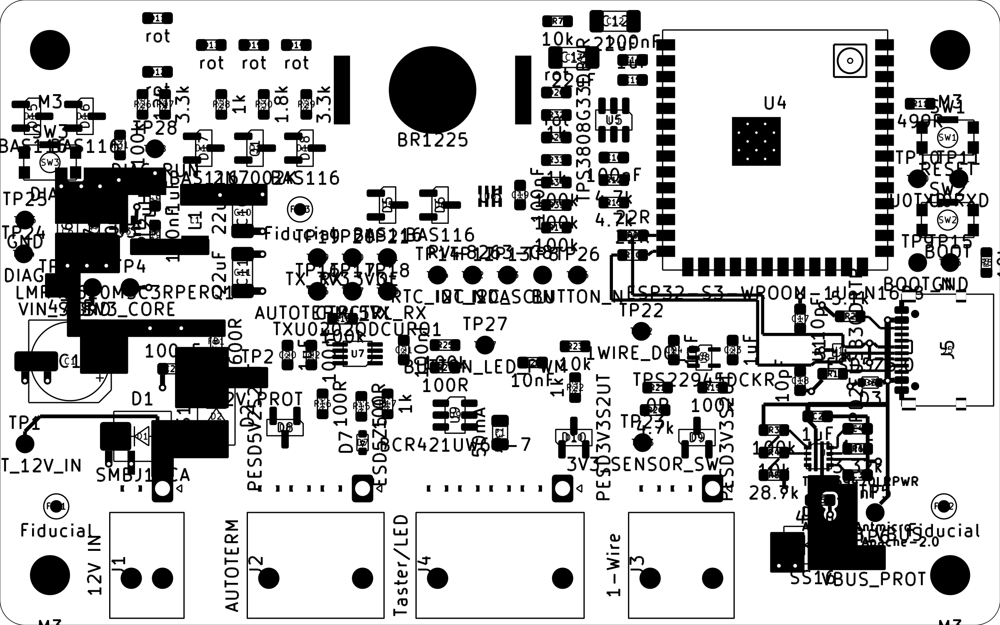

# Schritt 6 – Routing (hybrid)

Freigegeben: Platzierung („that looks good, I approve. Please continue with step 6"); Methode Hybrid:
kritische Pfade von Hand (reproduzierbar per Skript), langsame Signale mit Freerouting bei fixierten Handrouten,
danach Durchsicht/Nacharbeit und DRC.

Werkzeuge (KiCad-Python, Board im Projektordner, Projektdatei-Schutz wie in CLAUDE.md):

```
python3 tools/place_v2.py     LandyHeater.kicad_pcb
python3 tools/route_manual.py LandyHeater.kicad_pcb   # Handrouten + R:-Flächen, füllt Innenlagen
python3 tools/silkscreen.py   LandyHeater.kicad_pcb
```

## 6.3 Handrouting – Stand



| Block | Inhalt | Datenblatt / Regel |
|---|---|---|
| A 12-V-Eingang | BATT-Fläche J1 → D1 (TVS direkt am Pin) → D2; 12V_PROT-Fläche zu C26/FB1; TP1-Abgriff über D1; GND-Vias an D1/C26/C1 | Y-06, V-01 |
| B Schaltregler U3 | VIN-Fläche über C6/C7 und U3-VIN/GND, kleine SW-Fläche U3 → L1, BOOT/VCC 0,15 mm kurz, FB-Abgriff (VOUT-Sense) abseits von SW, 3V3-Fläche C10/C11 mit Vias zu L3 | LMR43620 8.5.1 |
| C USB-C | D+: B6↔A6 per Schleife hinter den Padenden (kein Via); D−: B7 einziger Lagenwechsel (B.Cu-Brücke, 2 Vias); Paar über U1 (Durchfluss, GND-Via direkt an Pin 3); C17/C18 (DNP) mit dem Signalpad direkt auf der Leitung (stubfrei); Paar ohne weiteren Lagenwechsel über ungeteilter L2-GND zu R9/R10 am Modul; CC1/CC2 zu R1/R2 mit eigenen GND-Vias; VBUS oben/unten über B.Cu verbunden, D3 direkt an den unteren VBUS-Pads | TPD2EUSB30 10.1, Espressif, Y-03 |
| D eFuse U2 | ILM/DVDT/ITIMER direkt zu R6/C3/C4; EN/OVLO-Teiler R3–R5 an Pin 1/2; lokale GND-Insel (Pin 8, C2/C3/C4/R6) mit einem Sternpunkt-Via zu L2; OUT als VBUS_PROT-Fläche mit C5, D4-Anode, TP6; D4-Kathode als VIN-Fläche mit 2 Vias zu L3 | TPS25947 8.4.1 |

DRC (Projektboard, alle Schweregrade): **0 Verletzungen**; Parität: 1 Warnung (F1 Footprint-Filter PTC,
offener Punkt Phase 5). Offene Verbindungen: 168 – überwiegend Flächenpads ohne Via (GND, 3V3) und langsame
Signale (Freerouting).

### Routingbedingte Änderungen an der freigegebenen Platzierung (USB-Block)

Beim Entflechten des USB-Steckers zeigte sich, dass das Paar am Stecker genau eine Kreuzung braucht und C17/C18
nur stubfrei anschließen, wenn sie direkt auf der Leitung liegen. Deshalb:

| Bauteil | vorher | jetzt | Grund |
|---|---|---|---|
| U1 | (170,1; 128,0; 90°) | (167,0; 128,0; 90°) | Platz für D+-Schleife und D−-Brücke zwischen J5 und U1; U1 jetzt 4,1 mm vor den J5-Pads, Prüfgrenze von 2,5 auf 5,0 mm angepasst (TPD2EUSB30 10.1: „so nah wie möglich") |
| D3, R1, R2 | 0° | 180° | VBUS-/CC-Pad zur Steckerseite, GND-Pad nach innen |
| C17 / C18 | (164,0; 126,0; 270°) / (164,0; 130,0; 90°) | (164,0; 125,5; 90°) / (164,0; 130,45; 270°) | Signalpad berührt die D−/D+-Leitung, kein Stich; GND-Pad nach außen zum Via |
| R6, C4 | y 136,3 / 134,6 | y 135,9 / 134,3 | GND-Pin 8 frei nach rechts zum Sternpunkt, ILM gerade aus Pin 9 |

Prüfung `tools/check_placement.py`: keine Fehler (Sperrkorridor „USB-Paar zu U1" ergänzt).

### Abweichung USB-Paarabstand

Geplant war 0,25/0,13 mm (≈ 89–90 Ω). Die Netzklasse USB hat Abstand 0,15 mm; KiCad nimmt den größeren Wert,
die Regel „USB-Paar 0,13" in `LandyHeater.kicad_dru` greift daher nicht. Statt die Netzklasse zu lockern wird das
Paar mit 0,25/0,15 mm geführt (≈ 92 Ω, abzugleichen mit dem JLCPCB-Rechner, P3-03). Für USB Full Speed (12 Mbit/s)
ist das unkritisch (USB 2.0: 90 Ω ± 15 %).

### 6.3 Fortsetzung – Engstellen von Hand (Blöcke E–G)

| Block | Inhalt | Grund |
|---|---|---|
| E | U7 (VSSOP, 0,5 mm): GND/3V3-Innenpins unter den Gehäusekörper (1,55 mm Reihenabstand) zu je einem Via; U8.2 (SOT-23-5) zwischen Pin 3/4 nach unten zum Via | kein Platz für Vias neben den Innenpins |
| F | Linke Modul-Pinreihe: EN direkt C15.1 → U5.1 (Gasse zwischen C15 und U5); STATUS_LED_1/2 über L4 zu Landungs-Vias, dann auf L1 an die LED-Spalte; DIAG_RUN auf L1 unter U5 hindurch zum Via; SDA/SCL-Pull-ups R12/R13 in der Gasse vor der Via-Spalte; Fan-out-Vias (x 151,45) für RTC_INT, AUTOTERM TX/RX/OE, 1WIRE_DQ (Pin 21) | Freerouting findet im Streifen zwischen Modul und U5/C16/R12/R13 keinen Weg (Probeläufe 13–100 offen) |
| G | Ausgänge der Diagnose-Zuleitungen 12V_PROT/VBUS_PROT mit Via außerhalb ihrer Netzflächen | Rest auf L4 (statisch, ~1 mA; Ausnahme zu Y-03) |

Routingbedingte Platzierungsänderung: **R33 ↔ R34 getauscht.** Vorher wechselten sich die beiden Status-LED-Netze
in der Widerstandsspalte ab (R32 LED1, R33 LED2, R34 LED1, R35 LED2) – jede Lagenzuordnung erzwang Kreuzungen mit den
DIAG/RTC/I2C-Leitungen. Jetzt liegen je Netz die Pads untereinander; D21 erreicht R33.2 unter dem R34-Körper.

## 6.4 Flächenanbindung

`tools/route_planevias.py`: jedes SMD-Pad von GND/3V3_CORE/VIN_SYS ohne Verbindung zu seiner Ebene bekommt ein
Via mit kurzer Bahn (0,6/0,3 mm, kein Via-in-Pad, 0,2 mm zu fremdem Kupfer aller Lagen, L3-Teilung beachtet:
3V3-/VIN-Vias nur über ihrer Teilfläche; keine Vias unter dem Modulkörper; unter der Knopfzelle nur GND).
Ergebnis: alle Flächenpads angebunden (59 Vias, Rest über Handrouting).

## 6.5 Freerouting (langsame Signale)

`tools/freeroute.py` (Hand- und Flächenrouting gesperrt; Arbeitskopie in `build/freeroute`):

- Netzflächen „R: …" zusätzlich als Sperrflächen exportiert – Freerouting 2.1.0 behandelt DSN-Flächen auf Signallagen
  als durchlässig (Probe: 12V_PROT und DIAG_K quer durch die Reglerflächen, SW-Fläche zerteilt).
- L3 als Versorgungslage exportiert (kein Routing auf der geteilten Ebene).
- Viakosten 8 statt 50 (mit 50 meidet Freerouting L4 fast ganz); mehrere Läufe nacheinander, bester wird übernommen;
  harte Zeitgrenze je Lauf (ein Durchgang lief einmal 34 min); Nutzungsstatistik von Freerouting abgeschaltet.
- Übernahme nur neuer Bahnen auf offenen Signalnetzen (keine Zusätze auf Flächennetzen und fertig geroutenen Netzen).

Stand: Freerouting-Ergebnis noch nicht im Projekt; bester Probelauf vor den letzten Handrouten 19 offene Verbindungen.

## Nächste Schritte

1. Freerouting für die restlichen Signale, verbleibende Verbindungen von Hand.
3. Nacharbeit (45°, Umwege, Vias, GND-Rückführungsvias an Lagenwechseln), keine Vias unter der BT1-Klammer.
4. Außenlagen füllen (`tools/zones.py --fill-all`), GND-Stitching, DRC, Abschlussbericht mit Bildern.
